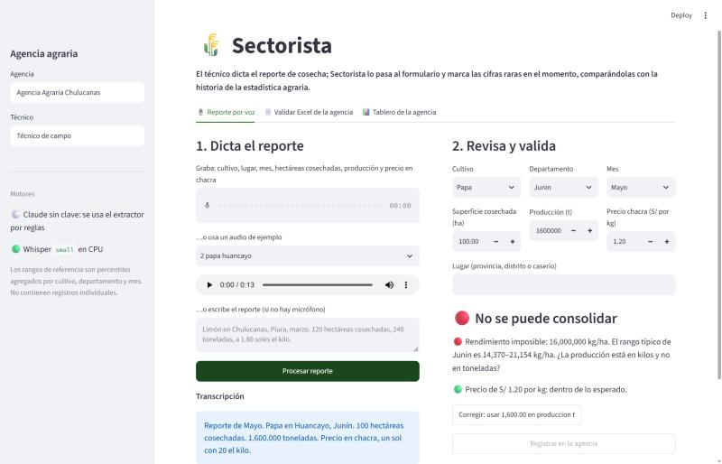
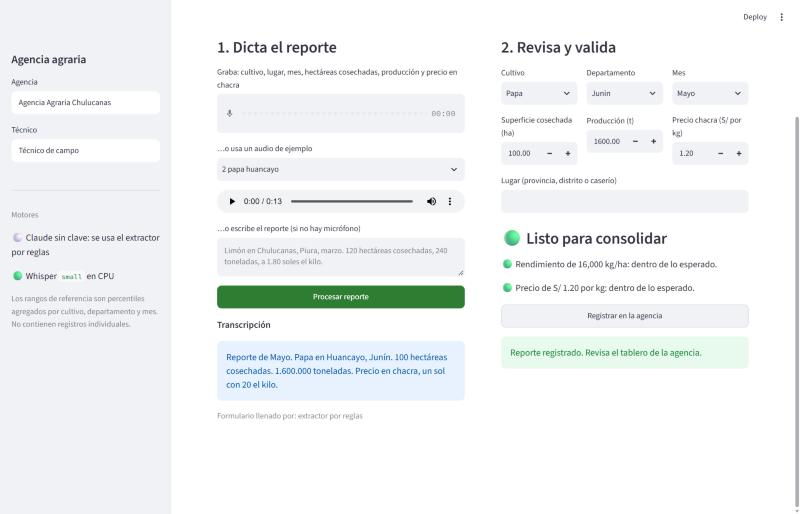
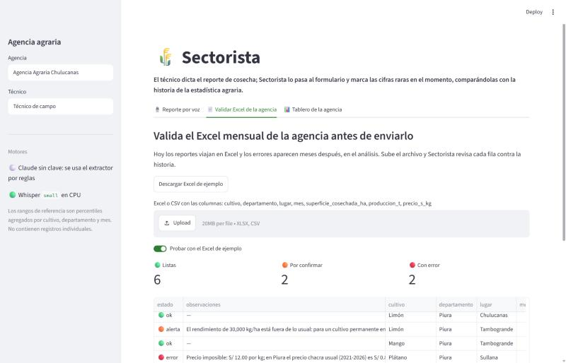
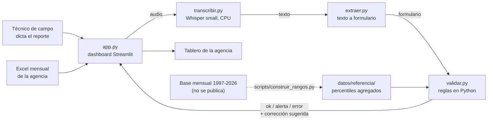

# 🌾 Sectorista

> **Hacemos que la estadística agraria llegue limpia desde el campo, para las agencias agrarias y el Ministerio, mediante un formulario por voz que valida cada cifra contra 20 años de historia en el momento en que se recoge.**

| | |
|---|---|
| **Demo** | URL pública: _pendiente de despliegue en Streamlit Community Cloud_ · corre en local (ver [Cómo correrlo](#cómo-correrlo)) |
| **Herramientas del curso** | Whisper (sesión 13) · Dashboard en Streamlit (sesión 05) |
| **Pruebas** | 10/10 (`pytest`) |
| **Presentación** | Diplomatura Q-Lab PUCP, 11 de noviembre de 2026 |



---

## 1. One-liner

**Hacemos** que los reportes de cosecha lleguen sin errores **para** las agencias agrarias y el Ministerio de Desarrollo Agrario **mediante** un formulario por voz que compara cada cifra con los rangos históricos del cultivo, el departamento y el mes, y pide confirmarla mientras el técnico todavía está con el productor.

## 2. Founder

**Josue Soria.** Trabajo en análisis económico del sector agrario público: estimo cómo afecta El Niño a la producción de cultivos como limón, plátano y palta por departamento, con la estadística agraria mensual. Soy usuario de esos datos todos los días, y los errores que Sectorista detecta son los que yo encuentro en los análisis exploratorios: rendimientos imposibles, producciones en kilos registradas como toneladas, precios con el decimal corrido. Conozco el dato desde dentro, a quién le llega y qué decisiones se toman con él.

## 3. Problema

**Quién lo sufre.** Los técnicos de campo de las agencias agrarias, que recogen cada mes cosechas, producción y precios en chacra; los equipos que consolidan esa información; y quienes la usan para decidir: el Ministerio, los gobiernos regionales y los analistas que estiman, por ejemplo, cuánto se pierde con un Niño costero.

**Cómo se resuelve hoy.** Los datos se recogen y se envían en Excel. Los errores no aparecen al recogerlos sino cuando alguien hace un análisis exploratorio, y para entonces ya no se puede volver a preguntarle al productor. Cada analista vuelve a limpiar las series antes de usarlas.

**Cuánto cuesta.** Horas de analistas detectando, descartando o corrigiendo cifras antes de cada análisis, sin poder volver al campo para confirmarlas. Cuando un error se escapa, termina en estimaciones de pérdidas, de abastecimiento o de precios. Los casos típicos son rendimientos que no pueden ser reales, producciones en kilos registradas como toneladas y precios con el decimal corrido.

**Evidencia de usuarios:** [`docs/research/`](docs/research/). Antes de la entrega **no logré hacer las 3 conversaciones con usuarios potenciales**, así que no hay entrevistas en el repositorio. Ahí documento mi experiencia como usuario y el plan de conversaciones.

## 4. Solución e insight

**Solución.** El técnico dicta el reporte ("papa, Huancayo, mayo, 100 hectáreas cosechadas, 1,600 toneladas, a un sol con veinte el kilo"). Whisper lo transcribe, el sistema llena el formulario y el validador revisa cada cifra:

- **Rendimiento implícito** (producción / superficie) frente a los percentiles históricos del cultivo en ese departamento.
- **Errores de unidades:** si dividir entre 1,000 deja la cifra en rango, pregunta "¿la producción está en kilos y no en toneladas?" y ofrece corregirla con un clic.
- **Precio chacra** frente a los precios de 2021-2026 del departamento, con detección de decimales corridos (12 en vez de 1.20).
- **Estacionalidad:** avisa si se reporta cosecha en un mes en que ese cultivo casi nunca se cosecha en ese departamento.
- **Coherencia:** hectáreas × rendimiento tienen que dar la producción reportada.

Para las agencias que siguen trabajando en Excel, Sectorista también valida el archivo mensual completo antes de enviarlo.

**Insight.** El error es barato de corregir en el campo y caro en Lima. Validar en el momento de la captura, contra la propia historia del dato, convierte una limpieza que se repite en cada análisis en una pregunta de diez segundos al productor. Y el validador no "opina": todas las cuentas las hace Python con rangos verificables.

## 5. Why now

- **Transcripción buena, gratis y sin internet.** Whisper (faster-whisper) corre en CPU, en una laptop o un servidor pequeño. En una prueba anterior del curso con audio en español peruano medimos un WER de 0.09 con el modelo turbo. Hace tres años no había modelos abiertos con esa calidad que corrieran sin GPU, y el técnico en la chacra muchas veces no tiene buena señal.
- **Datos suficientes para aprender lo "normal".** Con 20 años de estadística mensual por cultivo y departamento se pueden calcular rangos específicos, en vez de los límites fijos que alguien tiene que escribir a mano en un formulario.
- **Urgencia.** Con un Niño costero en curso, el Ministerio y los gobiernos regionales necesitan cifras de producción rápidas y confiables para estimar pérdidas.

## 6. Demo

**URL pública:** _pendiente_ · **Video de respaldo:** _pendiente_

| Dictado con error de unidades | Corrección con un clic | Excel de la agencia validado |
|---|---|---|
|  |  |  |

### Arquitectura



### Modelos y APIs

| Pieza | Qué usa | Por qué |
|---|---|---|
| Voz a texto | `faster-whisper` modelo `small`, int8 en CPU, con vocabulario agrario como pista | Gratis, sin API key y sin internet: el audio no sale del servidor. Transcribe un reporte de 14 s en 4-8 s. |
| Texto a formulario | Extractor por reglas (expresiones regulares + catálogo de cultivos, departamentos y meses) | Sin costo ni claves. Entiende cifras en dígitos, unidades (toneladas, kilos, quintales) y precios dichos como "un sol con veinte". |
| Texto a formulario (opcional) | Claude con salidas estructuradas (Pydantic), si se configura `ANTHROPIC_API_KEY` | Para dictados más libres ("dos mil cuatrocientos", frases desordenadas). Extrae valor y unidad tal como se dijeron; las conversiones las hace Python. **No está activo en el demo público.** |
| Validación | Python + percentiles agregados | Determinística y verificable: ninguna cifra la decide un modelo. |

### Datos

Los rangos de referencia ([`datos/referencia/`](datos/referencia/)) se calcularon con la estadística agraria mensual (producción, superficie cosechada y precio en chacra de 21 cultivos en 26 departamentos). **Solo se publican estadísticas agregadas**: percentiles por cultivo, departamento y mes, con un mínimo de 8 observaciones. La base no se publica. Los registros absurdos se descartan con un recorte robusto (mediana ± 4 MAD en escala logarítmica). Los audios de ejemplo usan una voz sintética y el Excel de ejemplo tiene datos sintéticos.

### Cómo correrlo

```bash
git clone https://github.com/josuesoriavas/sectorista.git && cd sectorista
python -m venv .venv && .venv/Scripts/activate   # en Linux/Mac: source .venv/bin/activate
pip install -r requirements.txt
streamlit run app.py
```

Pruebas: `pip install pytest && pytest -q`. La primera transcripción descarga el modelo de Whisper (~460 MB). No hace falta ninguna clave.

## 7. Modelo de negocio

**Quién paga:** el Estado. El comprador natural es el Ministerio (para todas las agencias) o cada gobierno regional para sus agencias agrarias. La entrada es un **piloto en una región** (por ejemplo, las agencias de Piura), financiado por el gobierno regional o por un proyecto de cooperación.

**Precio:** **S/ 450 al mes por agencia agraria** (licencia anual de S/ 5,400), con usuarios ilimitados. Piloto de una región con 10 agencias durante 6 meses: S/ 27,000.

**Costo por usuario (estimado):**

| Concepto | Cálculo | Costo |
|---|---|---|
| Tokens | El producto base no usa LLM | US$ 0 |
| Servidor (Whisper en CPU) | una VM de 4 vCPU por región, ~US$ 40/mes, compartida por ~10 agencias | ~US$ 4 por agencia al mes |
| **Total por agencia** | | **~US$ 4/mes (~S/ 15)** frente a S/ 450 de precio |
| Con el LLM opcional | ~1,000 tokens de entrada y ~300 de salida por reporte, ~300 reportes por técnico al mes | + ~US$ 3 por técnico al mes |

El demo público corre gratis en Streamlit Community Cloud.

## 8. Herramientas del curso

| Herramienta | Archivo | Por qué esta |
|---|---|---|
| **De la voz al texto con Whisper** (sesión 13) | [`sectorista/transcribir.py`](sectorista/transcribir.py) | El técnico está en la chacra, muchas veces sin buena señal y con las manos ocupadas: dictar es más rápido que escribir. Whisper corre sin internet y sin costo por uso. |
| **Dashboards** (sesión 05) | [`app.py`](app.py) | El producto es un dashboard en Streamlit: formulario validado, revisión del Excel de la agencia con indicadores de errores y tablero de reportes. Se despliega gratis. |
| LLM con salidas estructuradas (sesión 08), opcional | [`sectorista/extraer.py`](sectorista/extraer.py) | Implementado para dictados libres; se activa con una API key. |

## 9. Qué hizo el agente

Usé Claude Code para construir el producto. **Generó** el script que calcula los rangos agregados (`scripts/construir_rangos.py`), el validador (`sectorista/validar.py`), el extractor por reglas y el opcional con salidas estructuradas (`sectorista/extraer.py`), la transcripción (`sectorista/transcribir.py`), la app (`app.py`), las 10 pruebas y el borrador de este README. **Yo** elegí el problema a partir de mi trabajo, aporté la base y el conocimiento de cómo se recoge y se usa el dato, decidí publicar solo rangos agregados y no usar API keys en el demo, y revisé las reglas de validación. El script de voz sintética (`scripts/voz_windows.ps1`) viene de una tarea anterior del curso.

---

## Opcional

**Competencia.** Los sistemas de captura en formularios móviles (tipo KoBoToolbox u ODK) validan rangos fijos que alguien tiene que escribir a mano; no aprenden de la historia del cultivo ni entienden voz. Las hojas de Excel con validación de datos tienen el mismo límite.

**Primeros usuarios.** Una agencia agraria que acepte probarlo un mes en paralelo a su Excel, para medir cuántos errores se detectan en campo frente a los que aparecen después.

**Roadmap.** (1) Las 3 conversaciones con usuarios (técnico, consolidador y analista); (2) versión instalable sin internet para la agencia; (3) captura en quechua; (4) rangos que se actualizan con cada mes consolidado; (5) tablero regional con la tasa de errores por agencia.

**Riesgos.** Que el técnico confirme por inercia cifras raras (mitigación: pedir una observación cuando confirma); que los rangos penalicen cambios reales, como una caída por El Niño (mitigación: las alertas piden confirmar, no bloquean); y la compra pública, que es lenta (mitigación: piloto pagado por un gobierno regional o por cooperación).

## Licencia

MIT. Ver [`LICENSE`](LICENSE).
